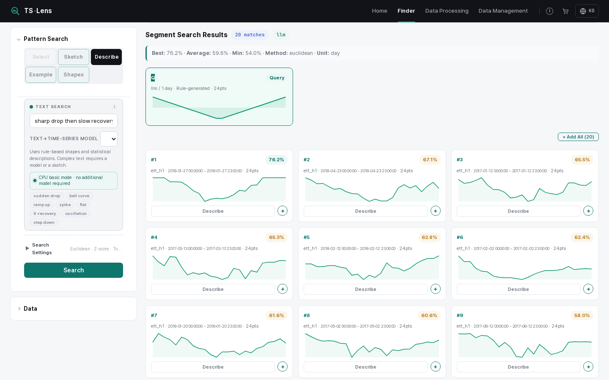
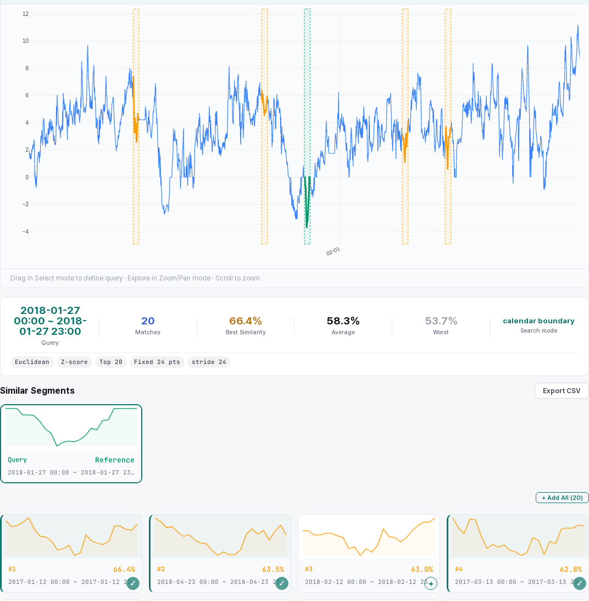
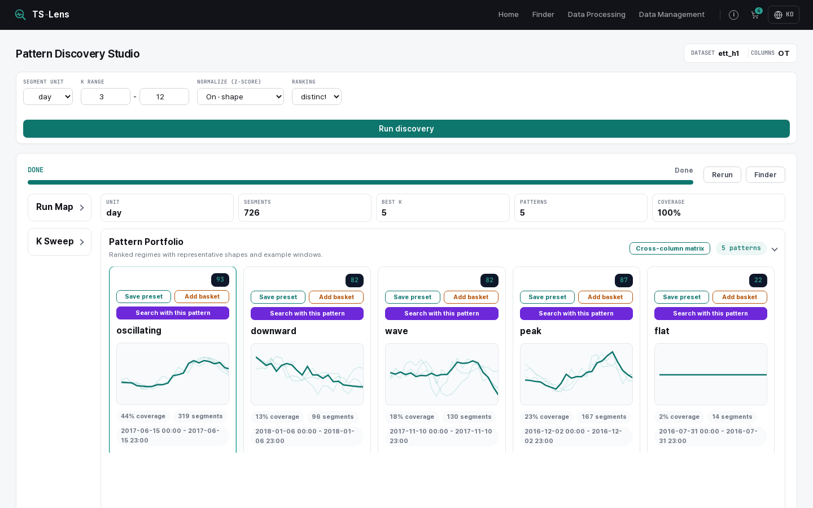
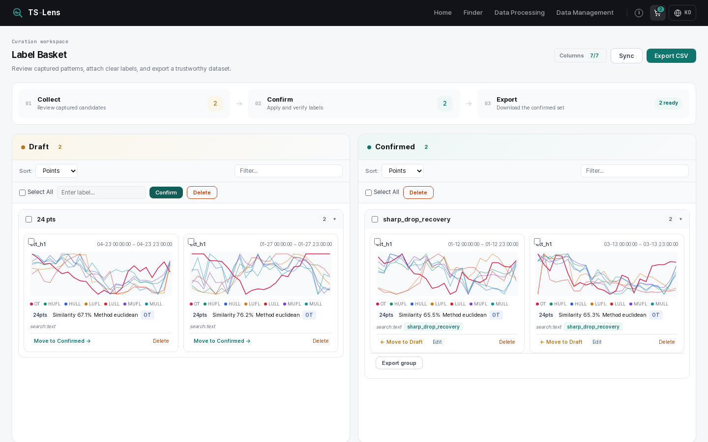

<div align="center">

# TS-Lens

### A Zero-Shot Time-Series Pattern Search System with Inspectable Waveform Queries

Jaewon Moon, Jihoon Lee

Korea Electronics Technology Institute (KETI)

**CIKM 2026 · Demo Track**

[](https://youtu.be/rAVoYtdQIcA)
[](#citation)
[](LICENSE)
[](#installation)

**English** · [한국어 가이드](docs/GUIDE.ko.md)

</div>

<p align="center">
  
</p>
<p align="center"><sub>Text query <i>"sharp drop then slow recovery"</i> on ETT-h1 oil temperature, split into one-day windows. The generated query waveform (Query card) is shown next to the ranked matches. Built-in rule generator, no LLM.</sub></p>

## News

- **[2026.10]** Code is released with an English README and a Korean guide.
- **[2026.11]** TS-Lens will be demonstrated at CIKM 2026 in Rome, Italy.

## Overview

Analysts often know the pattern they want to find, but they do not have an example segment to search with. Query-by-example needs such a segment. Sketch tools need a drawing. Language-based retrieval often depends on fixed query grammars or on a trained text–time-series model.

TS-Lens turns language into a **visible query**. Its core interaction is **Describe–Generate–Search (DGS)**:

1. **Describe** the pattern in plain language.
2. **Generate** a normalized waveform from the text with a language model.
3. **Search** with the same similarity layer that sketches, presets and examples use.

No retriever is trained, so the system is zero-shot. Because the waveform is visible, a wrong generation is easy to spot. You can fix it by rewriting the text, drawing a sketch or picking a preset.

> [!NOTE]
> The paper describes checking the waveform *before* search. In this code, TS-Lens generates the waveform and searches in one step, then shows the waveform in the Query card next to the results.

## Highlights

- **Six query modes, one search layer.** Text, Sketch, Preset, Select, Sample and Cluster all become comparable query objects.
- **Zero-shot.** Standard distances (Euclidean, cosine, DTW, shape). No task-specific training.
- **Text ↔ time series.** Text-to-series search, plus series-to-text explanations from statistics or an optional LLM such as ChatTS.
- **Discovery.** Recurring segments are grouped and shown by a real observed medoid, not a synthetic average.
- **Curation.** Label Basket with Draft and Confirmed labels, CSV export and reusable custom presets.
- **CPU first.** Search, clustering and the web UI need no GPU. LLM backends are optional and pluggable.

| Query mode (paper) | UI label | You give | View |
|---|---|---|---|
| Text | Describe | A sentence, turned into a waveform | Full, Segment |
| Sketch | Sketch | A freehand drawing | Full, Segment |
| Preset | Shapes | A built-in shape (`rise`, `fall`, `flat`, `bell`, `v_shape`, `spike`, `dip`) or a saved one | Segment |
| Select | Select | A range dragged on the chart | Full |
| Sample | Example | An observed segment card | Segment |
| Cluster | Discovery → *Search with this pattern* | A cluster medoid | Discovery |

## Demo

▶ **[3-minute demo video](https://youtu.be/rAVoYtdQIcA)**

| Select query in Full View | Discovery | Label Basket |
|:---:|:---:|:---:|
|  |  |  |

All screenshots use ETT-h1 with AI models turned off (`--mode off`).

## Installation

```bash
git clone https://github.com/CEDPProject/ts-lens.git
cd ts-lens
python3 -m venv .venv
source .venv/bin/activate
pip install -r requirements.txt
```

- Python 3.10 or newer. Tested on Linux with Python 3.10 and 3.11 (pandas 2 and 3).
- No GPU is needed for the base install.
- The browser loads Plotly and web fonts from CDNs, so it needs internet access.

## Quick Start

```bash
export TS_PATTERN_DB_PATH="$PWD/var/data.db"     # SQLite database
export TS_PATTERN_DATA_DIR="$PWD/var/uploads"    # uploaded original files
python app.py --mode off                         # start without any AI model
```

Open <http://localhost:7000/data> and try a bundled synthetic file:

1. Open the **Data Upload** tab and choose [tests/fixtures/single/01_basic_utf8.csv](tests/fixtures/single/01_basic_utf8.csv). Check the preview and click **Save to DB**.
2. Open **Finder**, pick the dataset and a column, and click **Load**.
3. In **Select**, drag a range on the chart and click **Search**. Or open **Sketch**, draw a shape and search.

Without the two variables, the database is `data.db` in the repository folder and uploads go to `../data`, a folder next to the repository. The server listens on `0.0.0.0:7000`. Change `app.host` and `app.port` in [config/app.yaml](config/app.yaml).

**Run modes.** `--mode` overrides `mode` in [config/runtime.yaml](config/runtime.yaml).

| Command | Behavior |
|---|---|
| `python app.py` | `auto`. Reuse or start the model servers that are ready. Fall back to rules and statistics. |
| `python app.py --mode cpu` | Use CPU-capable models only. |
| `python app.py --mode off` | Use no model. Rule waveforms and statistical descriptions only. |
| `python app.py --mode external` | Connect only to model servers that are already running. |
| `python app.py --check` | Print the startup decisions as JSON and exit. |

## LLM Backends (Optional)

The base install works without any model. Model weights are **not** included. Each model follows its own license.

| Model key | Task | Notes |
|---|---|---|
| `verbalts-synth` | Text → series | English only. CUDA or CPU, own venv. Port 7012 |
| `chatts-14b` | Series → text (default) | GPU, 8-bit. Loaded on request. Port 7014 |
| `exaone-ko-vllm` | Both | Korean. Served by vLLM. Port 8000 |
| `local-cpu-llm` | Both | Any Transformers causal LM on CPU. Port 7013 |
| `gemma3-en` | Text → series | Your own Ollama server |
| `external-llm` | Tasks you choose | Anthropic API or any OpenAI-compatible server, set in the UI |
| `cpu-basic` | Both | Built-in rules and statistics. Not an LLM |

The model catalog is in [config/model/text_ts.yaml](config/model/text_ts.yaml). Start commands and priorities are in [config/runtime.yaml](config/runtime.yaml). Model servers started by the app run in Hugging Face offline mode, so download weights beforehand.

<details>
<summary><b>Set up VerbalTS on CPU</b></summary>

```bash
python3 -m venv .venv-verbalts
.venv-verbalts/bin/python -m pip install torch flask numpy pyyaml transformers einops==0.8.2 gdown==6.2.0 huggingface_hub
.venv-verbalts/bin/python tools/models/setup_verbalts.py   # pinned upstream revision, SHA-256 checked
python app.py --mode cpu
```

</details>

<details>
<summary><b>Connect an external LLM (Anthropic or OpenAI-compatible)</b></summary>

1. Open `/data/models/external`.
2. Choose the provider, enter the model name and API key, and tick the tasks.
3. Click the connection test.

- The Anthropic provider needs `pip install anthropic`.
- Settings are stored in `config/local/external_llm.json` (git-ignored, mode 600). The key is never sent back to the browser.
- Upload metadata suggestion asks for up to 6,000 output tokens (`external_llm.meta_inference_max_tokens`). Give a self-hosted server a context window that fits the prompt plus this limit (for vLLM, `--max-model-len 16384` worked), or lower the setting.
- The text-mode rows of the paper's Table 2 used Qwen2.5-7B, Mistral-7B and Gemma3-12B. To try such a model, serve it with an OpenAI-compatible server (for example vLLM) and connect it here.

</details>

## Datasets

The paper demonstrates TS-Lens on three public datasets. **They are not included in this repository.** Download them from the sources, follow their licenses, and upload them on the Data Management screen.

| Dataset | Domain | Size | Source | License |
|---|---|---|---|---|
| ETT-h1 | Power equipment | 7 variables, 17,420 points | [ETDataset](https://github.com/zhouhaoyi/ETDataset) | CC BY-ND 4.0 |
| NREL Solar 2023 | Solar and weather | 10 variables, 105,120 points | [NREL SRRL BMS](https://data.nrel.gov/submissions/7) | Public NREL data |
| UCI Air Quality | Environmental sensing | 12 variables, 7,508 points after cleaning | [UCI ML Repository](https://doi.org/10.24432/C59K5F) | CC BY 4.0 |

Example presets for the keys `nrel_solar_2023` and `uci_air_quality` are in [config/custom_presets/](config/custom_presets/). A preset file applies only to a dataset registered under the same key.

## Results

Retrieval sanity check reported in the paper (Table 2).

| Query mode | nDCG@k | P@k |
|---|:---:|:---:|
| Sample (QBE) | 0.987 | 1.00 |
| Sketch | 0.926 | 0.93 |
| Preset | 0.853 | 0.93 |
| Text (Qwen2.5-7B) | 0.808 | 0.90 |
| Text (Mistral-7B) | 0.664 | 0.80 |
| Text (Gemma3-12B) | 0.611 | 0.60 |
| Non-text average | 0.922 | 0.96 |
| Text average | 0.694 | 0.77 |
| **Overall average** | **0.831** | **0.88** |

- A single evaluator graded each query's recorded top-*k* results on a four-level scale. k = 8 for the UCI Air Quality V-shape preset case and 10 for the others.
- Averages are query-level macro-averages over 15 cases (9 non-text, 6 text).
- This is a sanity check over recorded result sets, not a benchmark. This repository has no script that recomputes it.

## Tests

```bash
check_dir=$(mktemp -d)
TS_PATTERN_DB_PATH="$check_dir/data.db" TS_PATTERN_DATA_DIR="$check_dir/uploads" \
  python tools/audit_contracts.py
python tools/config_audit.py --strict
TS_PATTERN_DB_PATH="$check_dir/data.db" TS_PATTERN_DATA_DIR="$check_dir/uploads" \
  python -m unittest discover -s tests -t . -v
```

The suite has 154 unit tests. Four need PyTorch and are skipped in the base install. No GPU or model server is used.

## Documentation

The [Korean guide](docs/GUIDE.ko.md) covers operation, backup, the full API list and troubleshooting. The essentials in English:

<details>
<summary><b>Configuration and environment variables</b></summary>

Settings are YAML files in [config/](config/). Restart after editing.

| File | Controls |
|---|---|
| [config/app.yaml](config/app.yaml) | Host and port, CSV rules, segments, preprocessing, clustering, login, external LLM |
| [config/runtime.yaml](config/runtime.yaml) | Start mode and model services |
| [config/search.yaml](config/search.yaml) | Distance, Top-K, DTW, normalization |
| [config/model/text_ts.yaml](config/model/text_ts.yaml) | Model catalog and default model per task |
| [config/model/foundation.yaml](config/model/foundation.yaml) | MOMENT (optional imputation and embedding clustering) |
| [config/prompts.yaml](config/prompts.yaml) | Prompts for waveform generation and descriptions |

| Variable | Meaning | Default |
|---|---|---|
| `TS_PATTERN_DB_PATH` | SQLite file | `data.db` in the repository |
| `TS_PATTERN_DATA_DIR` | Uploaded original files | `../data`, next to the repository |
| `TS_PATTERN_SECRET_KEY` | Session signing key | Random per process |
| `TS_PATTERN_USERS_FILE` | Login accounts | `config/local/users.yaml` |
| `TS_PATTERN_EXTERNAL_LLM_FILE` | External LLM settings | `config/local/external_llm.json` |

</details>

<details>
<summary><b>Data format</b></summary>

- CSV or TSV with one time column and numeric value columns. Excel files are not read directly.
- Encoding and delimiter are detected automatically (UTF-8, CP949, EUC-KR, UTF-16, Latin-1; comma, tab, semicolon, pipe). You can override both in the preview.
- Duplicate time stamps are rejected by default. You can choose `first`, `last`, `mean` or `shift`.
- Up to 512 MB per upload (`csv.max_upload_mb`).
- Register one file (`single`), several files as separate sources (`collection`), or several files joined into one series (`merge`).
- Original bytes are kept as files. Values are stored in SQLite.
- [tests/fixtures/](tests/fixtures/README.md) has 23 single files and 4 folders of synthetic CSVs for edge cases.

</details>

<details>
<summary><b>Login (optional)</b></summary>

Without an account file, TS-Lens runs open. The first account turns login on for every page.

```bash
python tools/set_password.py admin --role admin   # asks for a password, stores a scrypt hash
python tools/set_password.py viewer --role user
```

- `admin` can do everything. `user` can explore, search, cluster and use the basket, but cannot change data or settings.
- Data is shared by all users.
- The server speaks plain HTTP. Put an HTTPS proxy in front before exposing it.

</details>

<details>
<summary><b>HTTP API</b></summary>

| Method | Path | Purpose |
|---|---|---|
| GET | `/api/runtime` | Run mode and chosen models |
| POST | `/api/upload`, `/api/import` | Preview a CSV, then store it |
| POST | `/api/load` | Load a column, returns `sid` |
| POST | `/api/search/<sid>` | Sliding-window search |
| POST | `/api/segment_search` | Segment search (`preset`, `custom` or `llm`) |
| POST | `/api/generate_pattern` | Text → waveform |
| POST | `/api/describe_segment` | Series → text |
| GET | `/api/basket/export` | Basket CSV |

```bash
curl http://127.0.0.1:7000/api/generate_pattern \
  -H 'Content-Type: application/json' \
  -d '{"description":"linear rise","length":24,"model_key":"cpu-basic"}'
```

All routes are listed in the [Korean guide](docs/GUIDE.ko.md#전체-api-경로).

</details>

## Citation

If you find TS-Lens useful, please cite:

```bibtex
@inproceedings{moon2026tslens,
  title     = {{TS-Lens}: A Zero-Shot Time-Series Pattern Search System with Inspectable Waveform Queries},
  author    = {Moon, Jaewon and Lee, Jihoon},
  booktitle = {Proceedings of the 35th ACM International Conference on Information and Knowledge Management (CIKM '26)},
  year      = {2026},
  address   = {Rome, Italy},
  publisher = {ACM},
  note      = {Demo paper, to appear}
}
```

## License

The code is released under the [MIT License](LICENSE). Python packages, model weights and datasets keep their own licenses.
