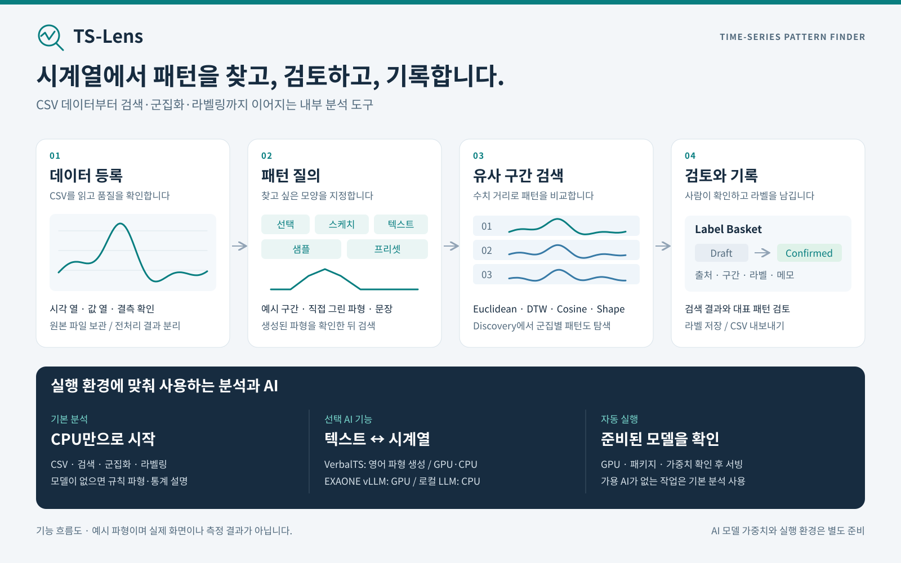

# TS-Lens · 시계열 패턴 탐색 도구

TS-Lens는 시계열 CSV에서 **관심 있는 모양을 찾고, 유사 구간을 비교하고, 검토 결과를 라벨로 남기는 웹 분석 도구**입니다. 사용자는 실제 구간을 선택하거나 스케치·문장·샘플·프리셋으로 검색 패턴을 만듭니다. Finder에서 유사 구간을 찾고, Discovery에서 반복되는 패턴을 군집으로 살펴본 뒤, Label Basket에 검토 결과를 저장합니다.

기본 데이터 처리와 수치 검색은 CPU에서 동작합니다. 텍스트→시계열 생성과 시계열→텍스트 설명에는 선택적으로 AI 모델을 연결할 수 있습니다. GPU가 필요한 모델과 CPU에서도 실행 가능한 모델을 구분하며, 준비된 AI 모델이 없으면 규칙 파형·통계 설명을 제공합니다. **`cpu-basic`은 신경망 모델이 아닙니다.**

이 문서는 설치·사용·운영·개발을 위한 **한국어 통합 안내서**입니다. 영어 개요는 저장소의 [README](../README.md)에 있습니다. 반복 가능한 검사는 [검증](#검증)에 정리했습니다.



[소개 도판 SVG](assets/ts-lens-brochure.svg) · [PNG](assets/ts-lens-brochure.png). 도판의 파형은 기능 설명을 위한 예시입니다.

## 목차

1. [제공 범위와 주요 화면](#제공-범위와-주요-화면)
2. [설치와 첫 실행](#설치와-첫-실행)
3. [데이터 등록과 파일 입출력](#데이터-등록과-파일-입출력)
4. [패턴 검색과 결과 해석](#패턴-검색과-결과-해석)
5. [군집 탐색과 라벨링](#군집-탐색과-라벨링)
6. [AI 모델과 실행 모드](#ai-모델과-실행-모드)
7. [설정과 폴더 구성](#설정과-폴더-구성)
8. [운영과 백업](#운영과-백업)
9. [개발 구조와 API](#개발-구조와-api)
10. [검증](#검증)
11. [문제 해결](#문제-해결)

## 제공 범위와 주요 화면

저장소에는 Flask 백엔드, 웹 화면, 설정, 검증 도구, 합성 CSV 예제가 들어 있습니다. 웹 UI는 한국어·영어를 지원합니다.

| 화면 | 주소 | 하는 일 |
|---|---|---|
| Data | `/data` | CSV 미리보기·등록, 데이터셋·원본 파일 관리 |
| Preprocess | `/preprocess` | 결측·이상치 진단, 전처리 결과 저장 |
| Finder | `/finder` | 패턴 질의, 유사 검색, 결과 비교·설명 |
| Discovery | `/discovery` | 세그먼트 군집화, 대표 패턴 검토. 상단 메뉴에는 없고 Finder 차트 머리의 **군집 탐색** 버튼으로 들어간다 |
| Label Basket | `/labeler` | 수집한 구간의 라벨·메모·검토 상태 관리 |
| Data › 모델 연결 | `/data/models/external`, `/data/models/local` (관리자) | 외부 LLM(Anthropic·OpenAI 호환) 연결·켜기/끄기·연결 시험, 이 서버의 모델 상태 |
| Login | `/login` | 계정 파일이 있을 때만 나타남 |
| About | `/about` | 기능 소개 |

수치 검색·K-Means·k-Shape·라벨링은 기본 의존성으로 사용합니다. MOMENT 기반 보간·임베딩과 AI 생성·설명은 별도 패키지와 가중치가 필요합니다. 연구용 provider 코드가 존재하는 것과 설치한 장비에서 모델이 준비되어 있는 것은 다릅니다.

로그인은 **최소 형태**로 있습니다(아래 [로그인](#로그인)). 계정 파일이 없으면 예전처럼 로그인 없이 열립니다. 사용자별 데이터 격리는 없고 데이터셋과 라벨은 설치본 전체에서 공유하므로 접근이 통제된 네트워크 안에서 운영합니다. 운영 데이터와 모델 가중치는 저장소에 포함하지 않습니다. 소스는 [MIT 라이선스](../LICENSE)로 공개하며, 외부 패키지·모델·데이터는 각각의 이용 조건을 따릅니다.

## 로그인

계정은 화면이 아니라 서버 파일로 관리합니다. **`config/local/users.yaml`이 없으면 로그인 기능 자체가 꺼져 있고**(개방 모드), 첫 계정을 넣는 순간부터 모든 화면이 로그인을 요구합니다.

```bash
python tools/set_password.py admin --role admin      # 비밀번호를 물어보고 해시만 저장(파일 600)
python tools/set_password.py viewer --role user
python tools/set_password.py --list
```

| 역할 | 할 수 있는 것 |
|---|---|
| `admin` | 전부 — 업로드·삭제·전처리 실행·칸 범위·모델 선택·외부 LLM 연결 |
| `user` | 탐색·검색·설명·군집·바구니(라벨 작업). 데이터와 서버 설정은 못 바꿈 |

관리자 전용 경로는 [backend/auth.py](../backend/auth.py)의 `ADMIN_RULES`(메서드+경로 패턴) 한 곳에 있습니다. 세션 유지 시간은 `app.yaml auth.session_hours`, 세션 쿠키 서명 키는 `TS_PATTERN_SECRET_KEY`(없으면 재시작마다 바뀌어 로그인이 풀립니다). 계정을 지우려면 파일에서 줄을 지우고, 로그인을 끄려면 파일을 지웁니다. 기본 실행은 HTTP라 비밀번호가 평문으로 오갑니다 — 외부 노출 시 앞단에 HTTPS 프록시를 둡니다.

## 설치와 첫 실행

Python 3.10 이상 문법을 사용합니다. 검사는 Linux의 Python 3.10·3.11(pandas 2·3) 환경에서 수행했습니다. 다른 운영체제·Python 버전에서는 [검증](#검증)의 검사를 먼저 실행합니다. 아래 명령은 모두 저장소 루트에서 실행합니다.

```bash
python3 -m venv .venv
source .venv/bin/activate
python -m pip install -r requirements.txt

# 새 설치본에서 사용할 저장 위치를 명시합니다.
export TS_PATTERN_DB_PATH="$PWD/var/data.db"
export TS_PATTERN_DATA_DIR="$PWD/var/uploads"

# 기본 기능부터 확인합니다. AI 서버를 시작하거나 호출하지 않습니다.
python app.py --mode off
```

브라우저에서 `http://localhost:7000/data`에 접속합니다. [기본 합성 CSV](../tests/fixtures/single/01_basic_utf8.csv)를 업로드하고, 미리보기에서 시각 열·값 열을 확인한 뒤 저장합니다. Finder로 이동하여 데이터를 로드하고 구간 선택 또는 스케치로 검색합니다. 예제별 차이는 [합성 CSV 목록](../tests/fixtures/README.md)을 참고합니다.

AI 실행 환경을 준비한 뒤에는 `python app.py`로 실행합니다. 장치·패키지·파일·서버 상태를 확인하여 사용할 모델을 선택합니다. 앱이 시작되었다고 모든 AI 모델의 추론까지 검증된 것은 아니므로 상태와 실제 생성·설명 요청을 함께 확인합니다.

기본 주소는 `0.0.0.0:7000`이며 [config/app.yaml](../config/app.yaml)의 `app.host`, `app.port`로 변경합니다. 로컬 장비에서만 접근하려면 `app.host`를 `127.0.0.1`로 설정합니다. 통합 진입점은 Waitress 한 프로세스·4스레드를 사용합니다. Flask 개발 서버나 WSGI 직접 import는 자동 모델 관리 절차를 실행하지 않습니다.

### 저장 위치와 환경변수

| 환경변수 | 의미 | 미설정 시 |
|---|---|---|
| `TS_PATTERN_DB_PATH` | SQLite 파일 | 저장소 루트의 `data.db` |
| `TS_PATTERN_DATA_DIR` | 업로드 원본 보관 루트 | **저장소 상위 폴더의 `data/`**(저장소 밖) |
| `TS_PATTERN_SECRET_KEY` | Flask 세션 비밀키 | 프로세스마다 임의 생성 |
| `TS_PATTERN_ASSET_VERSION` | 정적 파일 캐시 갱신값 | 프로세스 시작 시각 |

상대 경로는 터미널 위치가 아닌 저장소 루트를 기준으로 해석합니다. 환경변수는 시작 전에 지정하며 `.env` 자동 로드는 제공하지 않습니다. DB 부모 폴더와 원본 루트에 쓰기 권한이 필요합니다. **저장 경로를 바꿔도 기존 데이터는 자동 이동하지 않습니다.** 기존 설치를 이전할 때는 [백업·복원 절차](#백업과-복원)를 먼저 따릅니다.

## 데이터 등록과 파일 입출력

### 등록 절차

1. Data에서 파일과 등록 방식을 선택합니다.
2. 미리보기에서 인코딩·구분자·시각 열·값 열을 확인합니다. 감지가 틀리면 읽기 옵션을 직접 지정합니다.
3. 데이터셋 키와 중복 시각 처리 정책을 지정하여 저장합니다.
4. 저장 후 수용 보고서의 읽은 행 수·저장 행 수·제외 시각·중복·숫자 변환 경고를 확인합니다.
5. 필요하면 Preprocess에서 진단하고 전처리 결과를 저장한 뒤 Finder에서 사용할 데이터를 선택합니다.

`POST /api/upload`는 미리보기와 메모리 세션을 만듭니다. 실제 보관은 **`POST /api/import`**가 원본 파일을 다시 받아 수행합니다. 두 요청에 같은 읽기 옵션을 사용해야 합니다. 파일 미리보기만으로 영구 저장이 끝난 것은 아닙니다.

| 방식 | 결과 | 사용 예 |
|---|---|---|
| `single` | 파일 하나 → 데이터셋 하나·소스 하나 | 한 장비의 시계열 |
| `collection` | 같은 열 구성의 파일들 → 데이터셋 하나·파일별 독립 소스 | 지점별·설비별 시계열 비교 |
| `merge` | 같은 열 구성의 파일들을 연결 → 소스 하나 | 같은 관측 대상의 기간별 파일 연결 |

`collection`의 파일명은 확장자를 제외해도 서로 달라야 합니다. `merge`는 파일 간 중복 시각도 같은 정책으로 처리합니다. 서로 다른 지점을 하나의 연속 관측으로 오인하지 않도록 등록 방식을 구분합니다.

### 입력 계약

| 항목 | 처리 방식 |
|---|---|
| 파일 형식 | CSV/TSV 텍스트; multipart `file` 또는 `files`. Excel 통합문서는 직접 지원하지 않음 |
| 인코딩 | BOM 우선, 이후 설정 후보 평가; `encoding`으로 지정 가능 |
| 구분자 | 쉼표·탭·세미콜론·파이프 후보; `delimiter`로 지정 가능 |
| 값 열 | 숫자 복원 후 정규화; 숫자로 바꾸지 못한 값은 결측 처리·보고 |
| 시각 | 날짜·숫자·문자열 인덱스; 문자열 인덱스는 사전순 정렬 |
| 날짜 | 기본 `dayfirst: false`; 설정 비율 이상 해석 실패 시 거부 |
| 시간대 | 동일 시간대는 시간대를 제거하고 현지 시각 저장. UTC 변환이 아님 |
| 숫자 인덱스 | 정렬을 위한 0 채움, 소수부 최대 6자리, 기본 음수 거부 |
| 중복 시각 | 기본 `error`; 명시적으로 `first`, `last`, `mean`, `shift` 선택 가능 |
| 원본 | 업로드한 바이트 그대로 별도 보관; 정규화한 값은 DB 저장 |
| 크기 한도 | `config/app.yaml`의 `csv.max_upload_mb`; 여러 파일과 multipart 부가분을 합한 요청 전체 기준 |

자동 감지는 데이터 의미를 보장하지 않습니다. 혼합 시간대, 정밀한 숫자 인덱스, 날짜 저장 형식보다 짧은 관측 간격은 변환·중복 결과를 확인합니다. 수용 보고서는 데이터셋 메타데이터 `ingest`에 남습니다. `rows_imported`는 시계열 행 수이며, 여러 값 열을 펼쳐 저장한 DB 레코드 수와 다릅니다.

### 교체와 실패 시 보존

기존 데이터셋 키는 기본 **409**로 거부합니다. `replace=true`인 경우에만 교체합니다. 교체는 기존 소스와 연관 데이터를 재생성하므로 필요한 데이터는 먼저 백업합니다.

CSV import는 모든 파일의 정규화를 마친 뒤 DB 적재를 한 트랜잭션으로 처리합니다. 일반적인 적재·파일 쓰기 예외가 발생하면 롤백하고 새 원본을 정리합니다. 기존 원본은 교체 성공 후에만 정리합니다. 벤치마크 가져오기도 데이터·캐시 적재를 한 트랜잭션으로 처리하며 실패하면 새 원본을 정리합니다. 라벨 CSV는 전체 행의 필수값·신뢰도를 검증한 뒤 일괄 저장합니다. 전처리 재실행은 성공한 경우에만 기존 전처리 결과와 설정을 교체합니다.

DB와 파일시스템은 하나의 트랜잭션 저장소가 아닙니다. 강제 종료·전원 손실 때 미등록 새 파일이나 정리가 끝나지 않은 옛 파일이 남을 수 있습니다. 이를 임의로 삭제하지 말고 DB의 `stored_files`와 대조합니다.

데이터셋 키·파일 이름에는 경로나 제어문자를 허용하지 않으며, 한 요청의 중복 파일명을 거부합니다. 원본 보관 경로와 심볼릭 링크가 보관 루트 밖으로 나가면 거부합니다. 고유 접두사가 있는 실제 보관명과 사용자에게 표시할 이름을 `stored_files`에 따로 기록하며, 이전 버전의 보관 경로도 읽습니다.

### 삭제

Data 화면의 데이터셋 카드 아래 **삭제** 버튼은 지우기 전에 사라질 건수(소스·데이터 점·전처리된 점·정답 라벨·바구니 항목·패턴 정의·원본 파일)를 보여 주고, 데이터셋 키를 그대로 입력해야 실행된다. API(`DELETE /api/db/datasets/<key>?confirm=<key>`)도 같은 확인 키가 없으면 400으로 거부한다.

데이터셋을 지우면 다음이 함께 사라진다. 외래키 연쇄 삭제에 기대지 않고 코드가 직접 지운다.

| 위치 | 함께 지워지는 것 |
|---|---|
| DB | `sources`, `ts_data`, `segments`, `ts_data_preprocessed`, `preprocess_configs`, `ground_truth_labels`, `dataset_columns`, `dataset_cache`, `stored_files`, `basket_items`, `pattern_defs`/`pattern_instances` |
| 디스크 | 원본 CSV와 그 폴더, `config/custom_presets/<key>.yaml`과 숨김 목록 |
| 메모리 | 불러 둔 세션(`DATA_STORE`), 군집 준비 배열, 프리셋 캐시 |

소스 하나만 지울 때(`DELETE /api/db/sources/<source_key>`)도 그 데이터셋의 전처리 전체와 메모리 상태를 함께 비운다. 소스가 빠지면 기존 전처리 요약이 실제와 맞지 않기 때문이다. 같은 키로 덮어쓰기 재적재(`replace=true`)는 예외로, 바구니와 패턴은 유지하고 전처리만 지운다.

원본 파일 없이 DB에만 있는 데이터셋은 지우면 앱 안에서 다시 넣을 수 없다. 확인 창이 이 점을 경고한다. 지운 데이터셋의 바구니 항목이 옛 브라우저 저장분 이관으로 되살아나지 않도록 `POST /api/basket`은 없는 데이터셋의 항목을 거절한다.

### 다운로드와 내보내기

| 기능 | API | 내용 |
|---|---|---|
| 원본 목록 | `GET /api/db/datasets/<dataset_key>/files` | 등록된 파일명·상대 경로 |
| 원본 다운로드 | `GET /api/db/datasets/<dataset_key>/files/<filename>/download` | 가공하지 않은 원본 바이트 |
| 검색 결과 CSV | `POST /api/export/<sid>` | 순위·시작/끝 인덱스·길이·유사도·거리 |
| Basket CSV | `GET /api/basket/export` | 저장된 라벨 항목 내보내기 |

검색 결과 CSV 요청은 `results` 배열에 `start`, `end`, `length`, `similarity`, `distance`를 담습니다. 다섯 값은 유한한 숫자여야 합니다. 출력 열은 `rank,start_idx,end_idx,length,similarity,distance`이며 기본 UTF-8 BOM을 붙입니다(`csv.export_bom`). 이 API는 요청받은 결과를 직렬화하며 검색을 다시 수행하지 않습니다. 원본 다운로드·검색 결과 CSV·라벨 CSV는 각각 다른 목적입니다.

## 패턴 검색과 결과 해석

### 데이터 뷰와 질의 방식

연속 뷰는 한 배열에서 창을 이동하며 찾는 방식입니다. 세그먼트 뷰는 독립된 구간들을 비교합니다. 연속 데이터를 시간·포인트 단위로 분할하면 세그먼트 뷰에서 샘플과 프리셋 검색을 사용할 수 있습니다.

| 모드 | 연속 뷰 | 세그먼트 뷰 | 질의 만드는 방법 |
|---|---|---|---|
| Select | 가능 | 비활성 | 차트의 실제 구간을 드래그 |
| Sketch | 가능 | 가능 | 캔버스에 원하는 파형을 그림 |
| Text | 가능 | 가능 | 문장으로 파형을 생성한 뒤 검색 |
| Sample | 비활성 | 가능 | 구간 카드를 예제로 선택 |
| Preset | 비활성 | 가능 | 기본 형태 또는 저장한 사용자 패턴 선택 |

Select는 고정 길이·시작 정렬·stride를 조절할 수 있습니다. Sketch와 Text는 생성한 파형 길이와 실제 검색 창 길이를 확인합니다. 기본 프리셋은 `rise`, `fall`, `flat`, `bell`, `v_shape`, `spike`, `dip`이며, 전체 분류는 각 구간을 프리셋과 비교합니다. 프리셋 분류가 도메인의 정답 라벨을 보장하지는 않습니다.

Text의 연속 뷰는 `/api/generate_pattern`으로 파형을 만든 뒤 `/api/search/<sid>`로 검색합니다. 세그먼트 뷰는 `/api/segment_search`가 생성과 비교를 연결합니다. AI 모델은 검색용 파형을 만들며 최종 후보 선택은 수치 검색이 수행합니다. 문장의 시간 표현만으로 실제 시간대 필터가 적용된다고 가정하지 말고 생성 파형과 대상 구간을 확인합니다.

### 검색 설정 읽기

| 설정 | 의미와 주의점 |
|---|---|
| Euclidean | 구현상 점별 차이의 RMSE. 기본 비교 방식 |
| Cosine | 벡터 방향 비교. 정규화와 평탄 구간 처리에 영향을 받음 |
| DTW | 시간축 변형을 허용하는 비교. 긴 배열은 비교 길이를 줄일 수 있음 |
| Shape | 형태 특징을 추출하여 비교 |
| Z-score | 평균·규모 차이를 줄이고 모양을 비교. 상수 배열은 0 배열 처리 |
| 창 길이 | 후보 구간의 포인트 수. 관측 간격과 함께 해석 |
| Stride | 후보 시작점을 이동하는 간격. 커질수록 탐색량과 후보가 줄어듦 |
| Top-K·임계값 | 표시·반환할 결과 범위. “전체” 요청도 설정상 9999 상한값 사용 |
| 결측 정책 | 보간 또는 제외와 허용 비율. 원본 데이터를 수정하는 전처리와는 별개 |

수치 유사도는 확률·정확도가 아닙니다. 공통 계산에서는 Euclidean·DTW의 거리를 `1/(1+distance)`, Cosine·Shape를 `max(0,1-distance)`로 바꿉니다. 비교 방식·길이·정규화가 다르면 같은 점수를 같은 의미로 비교할 수 없습니다. DTW의 사전 후보 축소·다운샘플링 등 성능 경로도 있어 대규모 검색을 모든 원시점의 완전 탐색이라고 표현하지 않습니다.

연속 검색의 외부 파형(`query_values`: 스케치·생성 파형)은 서버에서 Z-score 정규화를 강제합니다. 선택 구간 검색은 `normalize` 설정을 따릅니다. 다중 컬럼 검색은 모드에 따라 같은 외부 파형을 보조 컬럼에 적용하거나 각 컬럼의 예시를 사용하므로, 어떤 컬럼과 형태를 비교했는지 결과에서 확인합니다.

### 독립 소스와 시간 경계

여러 지점·원본 세그먼트를 Full로 표시해도 시간적 연속성이 생기지 않습니다. 원본 경계를 넘는 선택 쿼리와 검색 후보는 허용하지 않습니다. 분할도 원본마다 다시 시작하며 A 지점의 꼬리와 B 지점의 앞부분을 합치지 않습니다.

- 시간 창은 `[시작, 다음 경계)`입니다. 10분 간격 관측이면 00:00~00:50의 6개 값이 온전한 1시간입니다.
- 주 컬럼의 누락·중복 시각, 비유한 값, 불완전한 처음·마지막 창은 제외합니다. 관측 간격은 원본별 양의 시각 차이 최빈값으로 추정하며 수집 주기 자체를 증명하지는 않습니다.
- 포인트 분할도 부족한 꼬리·결측·추정 간격에서 벗어난 창을 제외합니다.
- 보조 컬럼은 같은 소스·시각에 맞춥니다. 없는 값을 다른 지점에서 채우지 않습니다. 완전성 판정 대상은 주 컬럼입니다.
- Full의 `source_spans`는 끝 인덱스 제외, 분할 결과의 `start_idx`·`end_idx`는 원본 내 양 끝 포함입니다. `concat_start_idx`·`concat_end_idx`는 Full 표시 위치입니다.
- 결과의 `source_key`, `source_label`, `parent_segment_key`, `timestamps`를 출처 확인에 사용합니다. 구간 식별용 `key`와 지점 식별자는 다릅니다.

구간 카드 페이지 전환은 표시 범위만 바꿉니다. 전체 분할 응답을 만드는 비용까지 줄이지는 않습니다. 오래된 세션·Basket에 새 출처 정보를 소급 적용하지 않으므로 필요한 경우 원본을 다시 로드·분할합니다.

## 군집 탐색과 라벨링

Discovery는 Finder의 여섯 번째 질의 모드가 아니라 별도 화면입니다. Finder에서 데이터·컬럼·구간을 선택해 전달하고, 세그먼트를 준비한 뒤 군집화합니다. 현재 화면은 서버의 기본 알고리즘을 사용합니다. 군집 API는 K-Means·k-Shape·MOMENT 임베딩을 지원하며, MOMENT에는 추가 의존성과 가중치가 필요합니다. 여러 컬럼을 함께 묶는 joint 모드는 K-Means만 지원하고 다른 알고리즘 요청은 거부합니다.

`k: null`이면 Auto-K를 사용합니다. Silhouette·Calinski-Harabasz·Davies-Bouldin 등 지표와 전략 설정을 참고하여 군집 수를 제안합니다. medoid 설정을 사용하면 대표 패턴으로 실제 멤버를 고릅니다. 대표 파형, 군집 크기·일관성, 다른 컬럼과의 관계를 함께 검토합니다. 추천 군집 수나 일관성 배지는 사람이 확정한 의미 라벨이 아닙니다.

대표 패턴을 사용자 프리셋으로 저장하면 같은 데이터셋의 Finder 검색에서 재사용할 수 있습니다. “이 패턴으로 검색”은 프리셋 저장과 Finder 복원을 연결합니다. 프리셋은 데이터셋에 종속됩니다. 문자·숫자·밑줄·하이픈으로만 된 ID는 기존 `config/custom_presets/{dataset_id}.yaml`을 사용합니다. 그 밖의 문자를 포함하거나 `_hidden`으로 끝나는 ID는 이름 충돌을 막기 위해 `config/custom_presets/datasets/<SHA-256>/presets.yaml`과 `hidden.yaml`을 사용합니다. 기존에 이름을 치환해 저장한 파일이 발견되면 오류를 반환합니다. 백업 후 해당 데이터셋의 파일인지 확인하고 오류에 표시된 새 상대 경로로 복사합니다. API 반환의 `key`는 검색·목록용 표시 키, `storage_key`는 저장 키입니다.

검색·군집 결과를 Label Basket에 넣은 뒤 라벨·메모를 작성하고 Draft에서 Confirmed로 확정합니다. Basket은 출처와 결과 파형을 저장하며 원본 시계열을 덮어쓰지 않습니다. 내보내기는 기존 항목을 삭제하지 않습니다.

백그라운드 군집 요청은 일반 군집 요청과 같은 전처리·기간·컬럼 조건을 적용합니다. `config/app.yaml`의 `clustering.jobs`에서 동시 실행 수(기본 2), 보관 작업 수(16), 완료 후 보관 시간(1,800초), 작업별 진행 메시지 수(256)를 제한합니다. 실행 한도를 넘으면 HTTP 429를 반환합니다. 만료된 결과는 다음 작업 요청 시 정리하며, 이 상태는 프로세스 메모리에만 존재합니다.

### 상태가 유지되는 범위

| 상태 | 저장 위치 | 재시작·새로고침 영향 |
|---|---|---|
| 데이터셋·전처리·Basket | SQLite | 저장된 내용 유지 |
| 업로드 원본 | 원본 보관 루트 | 파일 유지, DB와 함께 복원 필요 |
| 사용자 프리셋 | YAML | 저장된 내용 유지 |
| Finder 로드 데이터·sid·검색 캐시 | 서버 메모리 | 서버 재시작 시 다시 로드 |
| 생성 파형·Discovery 계산 결과 | 브라우저 페이지 상태 | 페이지 이동·새로고침으로 사라질 수 있음 |
| Finder→Discovery 전달값 | `sessionStorage.discovery_selection` | 한 번 소비하는 전달 정보 |
| 자동 선택 모델·관리 실행 중 UI 선택 | 프로세스 메모리 | 재시작 시 실행 정책으로 다시 선택 |

Discovery에 직접 진입하거나 전달값 소비 후 새로고침했을 때 Finder에서 다시 선택하라는 안내가 나오는 것은 정상입니다. 장시간 작업의 중단 후 자동 복원은 보장하지 않습니다.

## AI 모델과 실행 모드

### 네 가지 실행 모드

```bash
python app.py                  # auto: 모델별 장치와 준비 상태 확인 후 실행
python app.py --mode cpu       # CPU 지원 AI 모델만 사용
python app.py --mode off       # AI 없이 규칙·통계와 기본 분석 사용
python app.py --mode external  # 이미 실행된 모델 서버에 연결, 새 서버 생성 없음
python app.py --check          # 조건 검사만 수행, 모델 서버 시작 없음
```

`--mode`가 [config/runtime.yaml](../config/runtime.yaml)의 `mode`보다 우선합니다. **CPU 모드는 AI를 끄는 모드가 아닙니다.** CPU 지원 모델의 가중치·환경이 준비되어 있으면 실제 AI 추론을 합니다. `off`는 AI provider 호출·시작과 추가 신경망 가중치 로드를 막습니다. `external`에서는 웹 앱 장비에 GPU가 없어도 원격 GPU 서버에 연결할 수 있습니다.

`--check`의 `startable`은 사전 조건이 맞는다는 뜻입니다. 전체 가중치의 무결성·모델 로딩·GPU 메모리·실제 추론 성공까지 검증한 결과는 아닙니다.

### 현재 모델 구성

| 모델 키 | 기능 | 장치·실행 조건 | 기본 연결 |
|---|---|---|---|
| `verbalts-synth` | 영어 Text→TS | CUDA 또는 CPU; 별도 환경·체크포인트 | `127.0.0.1:7012` |
| `chatts-14b` | TS→Text (기본) | GPU, 8비트 ~15GB, 요청 때만 올리고 5분 쉬면 내림; torch≥2.6·transformers 4.5x 환경의 별도 서버 | `127.0.0.1:7014` |
| `exaone-ko-vllm` | Text→TS·TS→Text | vLLM 패키지·EXAONE 가중치 폴더 필요(없으면 건너뜀) | `127.0.0.1:8000` |
| `local-cpu-llm` | Text→TS·TS→Text | 로컬 causal language model·Transformers·RAM | `127.0.0.1:7013` |
| `cpu-basic` | 명확한 문장→규칙 파형·통계 설명 | 추가 가중치 없음; LLM 아님 | 앱 내부 |
| `gemma3-en` | Text→TS | 별도 Ollama 서버·모델 준비; 통합 자동 시작 대상 아님 | provider 설정 참조 |

모델 등록·지원 작업·지원 장치·API 주소는 [config/model/text_ts.yaml](../config/model/text_ts.yaml), 시작 명령·우선순위·환경·상태 확인 주소는 [config/runtime.yaml](../config/runtime.yaml)에서 관리합니다. HF/VLM provider 구현이 있어도 현재 기본 전달 모델이나 검증 완료 기능이라는 뜻은 아닙니다.

기본 자동 실행은 낮은 `priority`부터 확인합니다. VerbalTS(10)가 Text→TS를, ChatTS(15)가 TS→Text를 맡고, EXAONE vLLM(20)이 가능한 나머지 작업을 맡으며, 로컬 CPU 언어모델(30)이 미배정 작업을 채웁니다. 준비된 AI가 없는 작업만 `cpu-basic`으로 남습니다. GPU가 없으면 GPU 전용 모델은 건너뛰고 CPU 지원 모델을 확인합니다. GPU가 있어도 파일·패키지가 없거나 시작에 실패하면 다음 후보로 진행합니다.

장치 허용 목록의 기준은 `models.<키>.inference_devices`입니다. 서비스별 Python에서 CUDA를 확인하고 `command`의 `{device}`에 선택 장치를 넣습니다. GPU 두 서비스가 같은 장치를 사용할 수 있으므로 필요한 메모리와 서비스 `enabled`·실행 옵션을 함께 조정합니다. 명령은 셸 문자열이 아닌 인자 배열입니다.

### 외부 LLM 연결과 업로드 메타 추정

관리자가 **데이터 관리 → 모델 연결**에서 Anthropic(Claude, 공식 SDK) 또는 OpenAI 호환 서버(OpenAI·Gemini의 OpenAI 엔드포인트·원격 vLLM 등, URL+키)를 연결합니다. 켜기/끄기, 모델 이름, 키, 표시 이름, 어디에 쓸지(문장→시계열 / 시계열→문장 / 업로드 메타 추정)를 고르고 **연결 시험**으로 확인합니다. 설정은 `config/local/external_llm.json`(git 밖, 600)에 저장되고 키는 화면으로 다시 나가지 않습니다(끝 4자리만). 켜져 있으면 체크한 작업의 모델 후보에 `external-llm`으로 나타나 탐색기에서 고를 수 있습니다. 호출 기본값(타임아웃·토큰 한도)은 `app.yaml external_llm.*`입니다.

**업로드 메타 추정**: 외부 LLM이 켜져 있고 "업로드 메타 추정"이 체크돼 있으면 업로드 미리보기에 **AI로 추정** 버튼이 나타납니다. 파일 이름·칸 이름·표본 행·칸별 통계·표본 간격을 보내 데이터셋 이름·설명·태그·칸별 라벨/단위/설명·주의점을 받아 폼에 미리 채웁니다(프롬프트는 `prompts.yaml dataset_meta_inference`). 제안일 뿐이라 비어 있는 칸만 채우고 사용자가 고쳐 저장합니다. 물리 범위 제안은 폼에 넣지 않고 메모로만 보여 줍니다 — 잘못 들어가면 전처리가 정상값을 범위 밖으로 자르기 때문입니다.

### 모델 준비

**ChatTS**(시계열→문장)는 시계열 값을 그대로 읽어 모양·사건을 영어로 서술하고, 앱이 계산한 통계(평균·표준편차·추세·주기)와 합쳐 구조화된 설명을 만듭니다. 개발 중 비교(표본 4개)에서 통계만 받는 텍스트 LLM(Qwen3.5-9B)·그래프를 보는 VLM(Qwen2.5-VL-7B)보다 모양 서술이 가장 충실했습니다. 다만 위치·수치를 가끔 틀리므로 숫자는 앱 통계가 정본입니다. 가중치 `bytedance-research/ChatTS-14B`(28GB, Apache-2.0)는 Hugging Face 캐시에서만 읽습니다(`local_files_only`). `.bin` 가중치와 원격 코드가 torch≥2.6·transformers 4.5x를 요구해 앱 환경이 아닌 `services.chatts.python`의 환경에서 [서빙 도구](../tools/models/serve_chatts.py)가 돕니다. `/health`와 `/describe` 두 경로뿐입니다. GPU를 다른 작업과 나눠 쓸 수 있도록 **요청이 올 때만 모델을 올리고 5분 동안 요청이 없으면 내립니다**(평소 GPU 메모리 0, 올라와 있을 때 8비트 ~15GB). 첫 요청은 로딩 때문에 수십 초(디스크 캐시가 식었으면 몇 분) 걸리고 그 뒤는 5~15초입니다. 장치·양자화·유휴 시간은 `runtime.yaml services.chatts.command`에서 바꿉니다.

**VerbalTS**는 `runtime/verbalts/`의 upstream 코드·체크포인트·토크나이저를 사용합니다. 기본 실행 Python은 `.venv-verbalts/bin/python`입니다. [설치 도구](../tools/models/setup_verbalts.py)는 명시적으로 실행할 때 외부에서 자산을 받습니다. upstream revision과 체크포인트 SHA-256을 검사합니다. 자동 앱 시작이 설치 도구를 대신 실행하지는 않습니다.

다음은 CPU 환경을 준비하는 예시입니다. 모델 패키지 전체 버전을 고정한 재현 환경은 아니므로 설치 후 실제 생성 요청으로 확인합니다. GPU 환경은 해당 장비의 PyTorch·CUDA 조합에 맞게 별도로 준비합니다.

```bash
python3 -m venv .venv-verbalts
.venv-verbalts/bin/python -m pip install torch flask numpy pyyaml transformers einops==0.8.2 gdown==6.2.0 huggingface_hub
.venv-verbalts/bin/python tools/models/setup_verbalts.py
python app.py --mode cpu
```

수동 서버 실행이 필요하면 `.venv-verbalts/bin/python tools/models/serve_verbalts.py --device cpu --port 7012`를 사용합니다. `/health`는 모델을 로드한 뒤 정상 응답합니다. 통합 실행은 준비된 서버를 재사용하거나 직접 시작하며, OS 부팅 시 자동 실행 등록까지 수행하지는 않습니다.

VerbalTS는 영어 입력용 실험 모델입니다. 한국어를 자동 번역하지 않습니다. 네이티브 길이 128·2채널 중 첫 채널을 검색 파형으로 사용하고, 요청 길이가 다르면 선형 보간합니다. `native_values`, `native_length`, `resampled`, `output_channel`, `seed`로 생성 정보를 확인합니다. 현재 서버는 50단계 DDIM·기본 seed 42를 사용합니다. 문장 확장 요청도 원문 파형 하나만 생성합니다. 서버 오류를 규칙 파형으로 숨기지 않습니다. 문장과 반대 방향의 파형이 나온 사례도 있으므로 생성 파형을 검토해야 하며 실제 도메인 정확도는 보장하지 않습니다.

**EXAONE vLLM**은 `runtime/exaone/`에 전체 모델 파일을 준비하고 `services.vllm.python`에 vLLM이 설치된 Python을 지정합니다. 비어 있으면 앱 Python을 사용합니다. 기본 사전 검사의 `config.json`·`tokenizer_config.json`만으로 가중치 전체가 준비되었다고 판단하면 안 됩니다. API 모델 ID와 `--served-model-name`, provider 주소와 상태 확인 주소를 맞춥니다.

**CPU 언어모델**은 `runtime/cpu_llm/`에 Transformers가 읽을 수 있는 causal language model의 전체 가중치·토크나이저·chat template을 준비합니다. `torch transformers flask`를 설치한 환경을 `services.cpu_llm.python`에 지정할 수 있습니다. [서빙 도구](../tools/models/serve_cpu_llm.py)는 CPU float32, 로컬 파일 로드, `trust_remote_code=False`를 사용합니다. 임의의 모델이 모두 호환되는 것은 아니며 모델 크기에 맞는 RAM과 지원 Transformers 버전이 필요합니다. 기본 소스에는 언어모델 가중치가 포함되지 않습니다.

### AI가 없을 때와 MOMENT

| 기능 | AI 가중치가 없거나 off인 경우 |
|---|---|
| CSV·전처리·수치 검색·K-Means·k-Shape·라벨링 | 기본 기능 사용 |
| 명확한 상승·하강·봉우리·골·평탄 문장 | 규칙 파형 생성 |
| 복합·모호한 문장 | 400 안내; 스케치 또는 준비된 AI 모델 사용 |
| 구간·다변량 설명 | 추세·변동성·상관 등 통계 결과, `engine=statistics`, `llm_used=false` |
| 문장 확장 | 기본 파형 하나; 추가 문장 생성 없음 |
| MOMENT 임베딩 군집화 | 모델 필요. 일반 군집화로 자동 대체된다고 가정하지 않음 |

MOMENT는 사용자용 Text↔TS 모델과 별도의 선택 모델입니다. [config/model/foundation.yaml](../config/model/foundation.yaml)에 모델·장치가 있으며 `momentfm`·PyTorch·가중치가 필요합니다. `cpu`에서는 CPU로 실행하고 `off`에서는 추가 가중치 로드를 차단합니다. 일부 보간·분석 경로는 기존 보간·통계로 대체할 수 있지만 임베딩 군집화까지 모두 같은 폴백을 제공하지는 않습니다. 선택 기능을 처음 호출할 때 모델 라이브러리가 가중치 다운로드를 시도할 수 있으므로 폐쇄망에서는 미리 캐시·의존성을 준비합니다.

### 결과 출처와 서버 수명

생성·설명 응답의 `engine`, `model`, `llm_used`, `fallback_reason`과 원문 응답을 확인합니다. 일반 LLM 경로는 `deterministic_first` 설정에 따라 명확한 형태어를 규칙으로 처리할 수 있으므로, 모델이 선택되었다고 모든 요청이 AI 추론인 것은 아닙니다. VerbalTS는 이 규칙 우회 경로를 사용하지 않습니다. VerbalTS는 신경망 파형 생성 모델이지만 LLM은 아니므로 `engine=verbalts`, `llm_used=false`를 반환합니다. 따라서 `llm_used=false` 하나만으로 AI 미사용이라고 판단하지 않습니다.

TS→Text의 추세·변동성·특징·요약·다변량 상관은 서버 계산값을 기준으로 유지하며 LLM이 덮어쓰지 않습니다. `field_sources`로 필드별 출처를 확인합니다. 통계 대체 결과를 LLM 성공으로 해석하지 않습니다.

`GET /api/runtime`은 실제 실행 모드·선택 상태, `/api/llm_models`와 `/api/llm_status`는 모델 가용성을 확인하는 진입점입니다. 기존 서버는 모델 식별·장치 조건을 확인하여 재사용합니다. 다른 모델이 같은 포트를 쓰고 있으면 이를 임의 종료하지 않습니다. 시작 시간 제한은 서비스별 `startup_timeout`이고 로그는 `runtime/logs/`에 남습니다.

정상 종료 때 앱이 직접 시작한 서버와 자식 프로세스만 정리합니다. 외부에서 시작한 서버는 유지합니다. SIGKILL·호스트 장애는 정리 코드를 실행할 수 없습니다. 자동 관리 중 선택 모델과 UI 변경은 메모리에만 반영하며 기존 YAML 선택을 덮어쓰지 않습니다. 통합 시작을 거치지 않는 수동 WSGI 실행의 모델 활성화는 YAML에 저장하는 기존 경로를 사용합니다.

## 설정과 폴더 구성

```text
ts-lens/
├── README.md                 # 영어 개요
├── LICENSE                   # MIT
├── app.py                    # Flask 구성과 통합 실행 진입점
├── requirements.txt          # 기본 의존성 파일 하나
├── backend/                  # API·검색·저장·모델 서비스
├── web/
│   ├── templates/            # Jinja HTML
│   ├── static/               # JavaScript·CSS·이미지
│   └── i18n/                 # 한국어·영어
├── config/                   # YAML 설정
│   ├── model/                # Text↔TS·MOMENT·한국어 어휘
│   └── custom_presets/       # 데이터셋별 사용자 프리셋
├── docs/
│   ├── GUIDE.ko.md           # 이 한국어 안내서
│   ├── assets/               # 소개 도판과 이미지
│   └── screenshots/          # README 화면 캡처
├── tests/                    # 회귀 검사
│   └── fixtures/             # 합성 CSV와 입력 목록
└── tools/                    # 검사·로그인 계정
    └── models/               # 선택 모델 준비·서빙
```

실행하면서 사용하는 아래 폴더는 소스와 성격이 다릅니다.

| 경로 | 용도 | 정리 기준 |
|---|---|---|
| `var/` | 이 안내서가 새 설치에 권하는 DB·원본 위치 | 운영 데이터이므로 백업·복원 대상으로 관리 |
| `runtime/` | 선택 모델 코드·가중치·토크나이저·모델 로그 | 임시 폴더가 아님. 사용 중 모델 자산을 지우면 재설치 필요 |
| `.venv/`, `.venv-verbalts/` | Python 실행 환경 | 설치 환경. 저장소에 넣지 않음 |
| `__pycache__/` | Python 바이트코드 캐시 | 재생성 가능 |

`var/`와 `runtime/`은 저장소에 미리 들어 있는 폴더가 아니며 `.gitignore`로 저장소 밖에 둡니다. 환경변수를 지정하지 않으면 DB는 저장소 루트의 `data.db`, 원본은 상위 폴더의 `data/`를 씁니다(호환용 기본값). `runtime`을 단순히 “불필요한 temp”로 삭제하지 않습니다.

### 설정 위치

| 파일 | 주요 설정 |
|---|---|
| [app.yaml](../config/app.yaml) | `app.host/port`, 업로드·날짜 정책 `csv.*`, 표시·분할·전처리·군집·프리셋 |
| [runtime.yaml](../config/runtime.yaml) | 시작 모드·서비스 우선순위·Python·명령·필수 파일·상태 확인 |
| [search.yaml](../config/search.yaml) | 거리·Top-K·DTW·정규화·결측 처리 |
| [text_ts.yaml](../config/model/text_ts.yaml) | `models`, `providers`, `task_active_models`, 지원 장치·생성 길이 |
| [foundation.yaml](../config/model/foundation.yaml) | MOMENT 모델 ID·장치 |
| [lexicon_ko.yaml](../config/model/lexicon_ko.yaml) | 한국어 형태어 힌트 |
| [prompts.yaml](../config/prompts.yaml) | 파형 생성·단일/다변량 설명 프롬프트 |
| [quick_start.yaml](../config/quick_start.yaml) | Finder 시작 카드 |
| [meta_presets.yaml](../config/meta_presets.yaml) | 데이터 메타데이터 입력 목록 |
| [custom_presets/](../config/custom_presets/) | UI로 저장한 데이터셋별 패턴(저장소에는 논문 데이터셋 예시 3개만, 새로 저장한 파일은 `.gitignore`) |

현재 검색 기본값은 Euclidean, 연속 Top-K 10, 세그먼트 Top-K 20, Z-score 활성화입니다. 생성 길이 범위는 5~2000, 기본 24입니다. 값 변경은 해당 YAML을 기준으로 합니다. 이 문서에 설정 파일 전체를 복제하지 않아 실제 설정과 설명이 따로 변하는 일을 줄입니다.

YAML 로더는 프로세스 캐시를 사용하므로 수동 편집 후 재시작합니다. 설정 파일 내 `${ENV_VAR}` 문자열을 자동으로 환경변수 치환하지 않습니다. 사용자 프리셋과 수동 실행의 모델 선택 저장은 임시 파일 작성 후 교체합니다. YAML 재직렬화로 주석·서식이 달라질 수 있으며, 여러 프로세스가 같은 설정을 동시에 수정하는 구성은 지원하지 않습니다.

## 운영과 백업

세션·검색 캐시는 프로세스 메모리에 있습니다. **한 앱 프로세스**로 운영하며 여러 worker·여러 서버에 요청을 분산하는 구성은 지원하지 않습니다. 프로세스 재시작·표준출력 로그 보관·프록시 인증은 기관의 운영 방식에 맞춰 구성합니다. 앱은 모델 서버의 시작·재사용·정리를 담당하지만 OS 서비스 등록은 제공하지 않습니다.

브라우저 차트는 Plotly CDN, 글꼴은 Pretendard(jsDelivr)와 JetBrains Mono(Google Fonts)를 참조합니다. 글꼴은 대체 표시될 수 있지만 차트는 외부 리소스 차단 시 동작하지 않을 수 있습니다. 이 저장소는 완전 폐쇄망 번들이 아닙니다. 폐쇄망에 설치할 때는 웹 자산의 로컬 제공, Python 패키지, 모델 캐시, 벤치마크 다운로드 경로를 별도로 준비·검증해야 합니다.

### 백업과 복원

1. 앱과 데이터 수정 작업을 중지합니다.
2. SQLite 파일 및 남아 있는 같은 이름의 `-wal`, `-shm`, 원본 보관 루트 전체, `config/` 전체를 함께 보관합니다.
3. 운영 환경변수, `python -m pip freeze` 결과, 별도 모델 환경·자산 위치를 기록합니다.
4. 복원할 때 DB와 원본의 상대 경로 관계를 유지하고 두 환경변수를 함께 지정합니다.
5. Data 목록·원본 다운로드·전처리·기존 라벨을 확인한 뒤 운영을 재개합니다.

실행 중 SQLite 본체 파일만 복사하는 방식은 사용하지 않습니다. DB만 복원하면 원본 다운로드가 복구되지 않으며, 원본만 복사해도 데이터셋 등록·라벨이 복구되지 않습니다. 세션 ID·메모리 검색 결과는 백업되지 않으므로 재시작 후 데이터를 다시 로드합니다.

## 개발 구조와 API

[app.py](../app.py)가 Flask와 blueprint를 구성합니다. [backend/startup.py](../backend/startup.py)는 통합 시작·모델 프로세스 관리, [runtime_state.py](../backend/runtime_state.py)는 현재 모드·선택을 관리합니다. 웹 자산의 물리 경로는 `web/` 아래지만 브라우저 URL은 `/static/`을 유지합니다.

| 변경할 기능 | 구현 진입점 |
|---|---|
| CSV 읽기·수용 | [csv_ingest.py](../backend/csv_ingest.py), [upload.py](../backend/routes/upload.py) |
| DB·원본 경로 | [db.py](../backend/db.py), [runtime_paths.py](../backend/runtime_paths.py) |
| 거리·파형 비교 | [helpers.py](../backend/helpers.py), [segment_search.py](../backend/segment_search.py) |
| 출처·경계 | [source_provenance.py](../backend/source_provenance.py), [data_transform.py](../backend/routes/data_transform.py) |
| 전처리 | [preprocess_service.py](../backend/preprocess_service.py), [preprocessing.py](../backend/preprocessing.py) |
| 군집 알고리즘 | [clustering/](../backend/clustering/), [segment_cluster.py](../backend/segment_cluster.py) |
| AI 생성·해석 | [llm_service.py](../backend/llm_service.py), [llm_providers.py](../backend/llm_providers.py), [llm_analysis.py](../backend/llm_analysis.py) |
| API와 웹 UI 연결 | [routes/](../backend/routes/), [finder/](../web/static/js/finder/) |
| 설정 로더 | [app_config.py](../backend/app_config.py) |

Agent 모듈은 서비스 호출을 정리하는 계층입니다. Interpreter·Retriever·Labeler는 일부 라우트에서 사용하지만 Curator는 현재 라우트에 연결되지 않습니다. 모든 요청이 네 Agent를 순서대로 거친다고 설명하지 않습니다.

Finder의 번호가 붙은 JavaScript는 ES 모듈이 아닌 공유 전역 스코프의 클래식 스크립트입니다. 템플릿의 로드 순서와 초기 실행 시 의존 관계를 유지합니다. 새 군집 알고리즘은 `BaseClusterAlgorithm`·`ClusterResult` 계약과 등록부, 새 AI 모델은 provider·지원 작업·장치·실행 설정을 함께 맞춥니다. 번역 변경은 `web/i18n/ko.json`과 `en.json`을 함께 수정합니다.

### 주요 API 사용 규칙

파일 수용은 multipart, 나머지 주요 계산·수정 요청은 JSON을 사용합니다. 아래 `<...>`는 Flask 경로 변수입니다. 모든 엔드포인트를 하나의 통일된 요청·응답 스키마로 감싸지는 않으므로 정확한 필수 필드와 오류 처리는 표의 라우트 구현을 기준으로 합니다.

- `POST /api/load`: `dataset_key`, `primary_col`, 선택 `overlay_cols`로 로드하고 응답의 `sid`를 후속 검색에 사용합니다.
- `POST /api/search/<sid>`: 선택 구간은 `query_start`·`query_end`(끝 포함), 외부 파형은 `query_values`; `method`, `normalize`, `fixed_len`, `stride`, `top_k` 등을 전달합니다.
- `POST /api/segment_search`: `dataset_key`, `col_name`, `unit`, `query_type`과 질의별 필드(`preset_name`, `nl_description` 등)를 전달합니다.
- `POST /api/segment_search/prepare_cluster`: 준비 결과의 실제 `cache_key`를 사용합니다. 키 형식을 임의로 조합하지 않습니다.
- `POST /api/generate_pattern`: `description`, `length`, 선택 `model_key`를 전달합니다. 생성값과 `engine/model/llm_used`를 함께 보관합니다.
- `POST /api/describe_segment`: `values`, 선택 `timestamps`, `col_name`, `dataset_key`, `model_key`. 다변량 API는 무효 컬럼을 제외하고 유효 컬럼명으로 해석을 결합합니다.
- `POST /api/llm_models/activate`: `model_key`, `task`(`text_to_ts` 또는 `ts_to_text`); 관리 실행 중 변경은 프로세스 내 선택입니다.
- `POST /api/basket`: `items` 배열. 항목 변경은 `PUT /api/basket/<int:item_id>`의 `label`, `status`, `note`를 사용합니다.

다음은 규칙 파형을 요청하는 실행 가능한 예시입니다. AI 품질 검사 요청은 아닙니다.

```bash
curl http://127.0.0.1:7000/api/runtime
curl http://127.0.0.1:7000/api/generate_pattern \
  -H 'Content-Type: application/json' \
  -d '{"description":"linear rise","length":24,"model_key":"cpu-basic"}'
```

대표 오류는 400(입력·지원 범위), 404(없는 데이터·세션), 409(등록 충돌), 413(업로드 한도), 429(백그라운드 군집 동시 실행 한도), 500(서버 처리 실패)입니다. 모든 API가 동일한 오류 매핑을 보장하지는 않습니다. 응답의 `error`와 서버 로그를 확인합니다. 변경 API에 JSON을 보낼 때 최상위는 객체여야 합니다. Basket 여러 항목 추가는 항목별 성공·오류를 반환하므로 응답의 `errors`도 확인합니다. JSON에서 NaN·Infinity는 `null`로 표현합니다.

### 전체 API 경로

아래 목록은 현재 라우트 선언에서 확인한 메서드·경로·구현 위치입니다. 브라우저 페이지와 Flask 자동 OPTIONS/HEAD는 제외합니다. 파일명이 같은 행은 같은 구현 파일을 가리킵니다.

| 메서드 | 경로 | 구현 |
|---|---|---|
| GET, POST | `/api/basket` | [basket_routes.py](../backend/routes/basket_routes.py) |
| DELETE, PUT | `/api/basket/<int:item_id>` | [basket_routes.py](../backend/routes/basket_routes.py) |
| GET | `/api/basket/<int:item_id>/data` | [basket_routes.py](../backend/routes/basket_routes.py) |
| DELETE, PUT | `/api/basket/bulk` | [basket_routes.py](../backend/routes/basket_routes.py) |
| POST | `/api/basket/bulk-data` | [basket_routes.py](../backend/routes/basket_routes.py) |
| GET | `/api/basket/columns` | [basket_routes.py](../backend/routes/basket_routes.py) |
| GET | `/api/basket/count` | [basket_routes.py](../backend/routes/basket_routes.py) |
| GET | `/api/basket/export` | [basket_routes.py](../backend/routes/basket_routes.py) |
| GET | `/api/basket/keys` | [basket_routes.py](../backend/routes/basket_routes.py) |
| POST | `/api/benchmark/import_nab` | [benchmark_import.py](../backend/routes/benchmark_import.py) |
| POST | `/api/benchmark/import_skab` | [benchmark_import.py](../backend/routes/benchmark_import.py) |
| GET | `/api/benchmark/status` | [benchmark_import.py](../backend/routes/benchmark_import.py) |
| GET | `/api/data/<sid>` | [data_load.py](../backend/routes/data_load.py) |
| POST | `/api/diagnose` | [data_load.py](../backend/routes/data_load.py) |
| POST | `/api/load` | [data_load.py](../backend/routes/data_load.py) |
| GET | `/api/segments/<dataset_key>/<col_name>` | [data_load.py](../backend/routes/data_load.py) |
| GET | `/api/concat_segments/<dataset_key>/<col_name>` | [data_transform.py](../backend/routes/data_transform.py) |
| POST | `/api/split_continuous/<sid>` | [data_transform.py](../backend/routes/data_transform.py) |
| GET, POST | `/api/column_limits/<dataset_key>` | [datasets.py](../backend/routes/datasets.py) |
| POST | `/api/column_limits/<dataset_key>/auto_compute` | [datasets.py](../backend/routes/datasets.py) |
| GET | `/api/datasets` | [datasets.py](../backend/routes/datasets.py) |
| GET | `/api/db/datasets` | [datasets.py](../backend/routes/datasets.py) |
| DELETE | `/api/db/datasets/<dataset_key>` | [datasets.py](../backend/routes/datasets.py) |
| GET | `/api/db/datasets/<dataset_key>/delete_summary` | [datasets.py](../backend/routes/datasets.py) |
| GET/PUT/DELETE | `/api/external_llm` | [external_llm_routes.py](../backend/routes/external_llm_routes.py) |
| POST | `/api/external_llm/test` | [external_llm_routes.py](../backend/routes/external_llm_routes.py) |
| POST | `/api/external_llm/infer_meta` | [external_llm_routes.py](../backend/routes/external_llm_routes.py) |
| POST | `/api/login`, `/api/logout` · GET `/api/auth/me` | [app.py](../app.py) |
| GET | `/api/db/datasets/<dataset_key>/files` | [datasets.py](../backend/routes/datasets.py) |
| GET | `/api/db/datasets/<dataset_key>/files/<path:filename>/download` | [datasets.py](../backend/routes/datasets.py) |
| POST | `/api/db/datasets/<dataset_key>/refresh_cache` | [datasets.py](../backend/routes/datasets.py) |
| GET | `/api/db/datasets/<dataset_key>/sources` | [datasets.py](../backend/routes/datasets.py) |
| DELETE | `/api/db/sources/<path:source_key>` | [datasets.py](../backend/routes/datasets.py) |
| GET | `/api/db/sources/<path:source_key>/preview` | [datasets.py](../backend/routes/datasets.py) |
| GET | `/api/labels` | [datasets.py](../backend/routes/datasets.py) |
| GET | `/api/meta_presets` | [datasets.py](../backend/routes/datasets.py) |
| POST | `/api/export/<sid>` | [export_routes.py](../backend/routes/export_routes.py) |
| POST | `/api/import_labels` | [label_import.py](../backend/routes/label_import.py) |
| GET | `/api/labels/<dataset_key>` | [label_import.py](../backend/routes/label_import.py) |
| POST | `/api/describe_segment` | [llm_routes.py](../backend/routes/llm_routes.py) |
| POST | `/api/describe_segment_multi` | [llm_routes.py](../backend/routes/llm_routes.py) |
| POST | `/api/generate_pattern` | [llm_routes.py](../backend/routes/llm_routes.py) |
| GET | `/api/llm_models` | [llm_routes.py](../backend/routes/llm_routes.py) |
| POST | `/api/llm_models/activate` | [llm_routes.py](../backend/routes/llm_routes.py) |
| GET | `/api/llm_status` | [llm_routes.py](../backend/routes/llm_routes.py) |
| GET | `/api/runtime` | [llm_routes.py](../backend/routes/llm_routes.py) |
| GET, POST | `/api/patterns` | [patterns.py](../backend/routes/patterns.py) |
| DELETE, GET, PUT | `/api/patterns/<int:pattern_id>` | [patterns.py](../backend/routes/patterns.py) |
| POST | `/api/patterns/<int:pattern_id>/instances` | [patterns.py](../backend/routes/patterns.py) |
| POST | `/api/patterns/<int:pattern_id>/refine` | [patterns.py](../backend/routes/patterns.py) |
| GET | `/api/patterns/export` | [patterns.py](../backend/routes/patterns.py) |
| PUT | `/api/patterns/instances/<int:instance_id>/status` | [patterns.py](../backend/routes/patterns.py) |
| GET | `/api/periodicity/<sid>` | [periodicity_routes.py](../backend/routes/periodicity_routes.py) |
| GET | `/api/periodicity_all/<dataset_key>` | [periodicity_routes.py](../backend/routes/periodicity_routes.py) |
| GET | `/api/preprocess/column_preview/<dataset_key>/<col_name>` | [preprocess_routes.py](../backend/routes/preprocess_routes.py) |
| POST | `/api/preprocess/delete` | [preprocess_routes.py](../backend/routes/preprocess_routes.py) |
| POST | `/api/preprocess/execute` | [preprocess_routes.py](../backend/routes/preprocess_routes.py) |
| GET | `/api/preprocess/interpolation_methods` | [preprocess_routes.py](../backend/routes/preprocess_routes.py) |
| GET | `/api/preprocess/status/<dataset_key>` | [preprocess_routes.py](../backend/routes/preprocess_routes.py) |
| GET | `/api/presets` | [preset_routes.py](../backend/routes/preset_routes.py) |
| POST | `/api/presets/builtin/<key>/hide` | [preset_routes.py](../backend/routes/preset_routes.py) |
| POST | `/api/presets/builtin/<key>/unhide` | [preset_routes.py](../backend/routes/preset_routes.py) |
| POST | `/api/presets/custom` | [preset_routes.py](../backend/routes/preset_routes.py) |
| DELETE | `/api/presets/custom/<key>` | [preset_routes.py](../backend/routes/preset_routes.py) |
| GET | `/api/presets/hidden` | [preset_routes.py](../backend/routes/preset_routes.py) |
| POST | `/api/presets/reset` | [preset_routes.py](../backend/routes/preset_routes.py) |
| GET | `/api/boundaries/<sid>` | [search.py](../backend/routes/search.py) |
| POST | `/api/search/<sid>` | [search.py](../backend/routes/search.py) |
| POST | `/api/search_segments/<dataset_key>/<col_name>` | [search.py](../backend/routes/search.py) |
| POST | `/api/search_split_segments/<sid>` | [search.py](../backend/routes/search.py) |
| POST | `/api/evaluate_cluster` | [segment_search_routes.py](../backend/routes/segment_search_routes.py) |
| POST | `/api/evaluate_clusters_llm` | [segment_search_routes.py](../backend/routes/segment_search_routes.py) |
| POST | `/api/moment/analyze_clusters` | [segment_search_routes.py](../backend/routes/segment_search_routes.py) |
| POST | `/api/moment/analyze_pattern` | [segment_search_routes.py](../backend/routes/segment_search_routes.py) |
| POST | `/api/segment_search` | [segment_search_routes.py](../backend/routes/segment_search_routes.py) |
| POST | `/api/segment_search/classify` | [segment_search_routes.py](../backend/routes/segment_search_routes.py) |
| POST | `/api/segment_search/cluster` | [segment_search_routes.py](../backend/routes/segment_search_routes.py) |
| GET | `/api/segment_search/cluster_config` | [segment_search_routes.py](../backend/routes/segment_search_routes.py) |
| POST | `/api/segment_search/prepare_cluster` | [segment_search_routes.py](../backend/routes/segment_search_routes.py) |
| GET | `/api/segment_search/presets` | [segment_search_routes.py](../backend/routes/segment_search_routes.py) |
| GET | `/api/segment_search/segment_cluster_progress/<job_id>` | [segment_search_routes.py](../backend/routes/segment_search_routes.py) |
| POST | `/api/segment_search/segment_cluster_stream` | [segment_search_routes.py](../backend/routes/segment_search_routes.py) |
| POST | `/api/segment_search/similar` | [segment_search_routes.py](../backend/routes/segment_search_routes.py) |
| POST | `/api/segment_search/subdivide` | [segment_search_routes.py](../backend/routes/segment_search_routes.py) |
| POST | `/api/segment_search/time_info` | [segment_search_routes.py](../backend/routes/segment_search_routes.py) |
| POST | `/api/import` | [upload.py](../backend/routes/upload.py) |
| POST | `/api/upload` | [upload.py](../backend/routes/upload.py) |

## 검증

### 반복 가능한 검사

운영 DB 대신 임시 경로를 지정하고 검사합니다. 아래 검사들은 GPU 모델을 새로 띄우거나 AI 품질을 평가하지 않습니다.

```bash
check_dir=$(mktemp -d)
TS_PATTERN_DB_PATH="$check_dir/data.db" TS_PATTERN_DATA_DIR="$check_dir/uploads" \
  python tools/audit_contracts.py
python tools/config_audit.py --strict
TS_PATTERN_DB_PATH="$check_dir/data.db" TS_PATTERN_DATA_DIR="$check_dir/uploads" \
  python -m unittest discover -s tests -t . -v   # -t . 가 있어야 tests/__init__ 의 격리(로컬 계정·키 파일 무시)가 적용된다
  # 로그인·외부 LLM 테스트: tests/test_auth.py, tests/test_external_llm.py
```

계약 검사는 Python 구문, YAML·번역 키, 문서 링크·목차, 정적 API 참조, 9개 주요 화면과 참조 정적 자산의 HTTP 렌더링을 확인합니다. 브라우저 클릭·차트 동작·대용량 성능까지 대신하지 않습니다.

## 문제 해결

| 증상 | 확인과 조치 |
|---|---|
| 빈 데이터 목록 | DB 환경변수와 기존 파일 위치 확인. 새 경로로 자동 이전되지 않음 |
| 원본 다운로드 404 | DB `stored_files.rel_path`와 원본 루트를 함께 복원했는지 확인 |
| 업로드 400 | 시각·값 열, 인코딩·구분자, 중복 정책과 수용 보고서 확인 |
| 업로드 413 | 요청 전체 크기와 `csv.max_upload_mb`, 앞단 프록시 한도 확인 |
| 프리셋 `Ambiguous legacy preset file` | 백업 후 파일의 실제 데이터셋을 확인하고 오류가 안내한 새 경로로 복사 |
| 레거시 Basket 중복 오류 | 기존 라벨을 보존하기 위해 초기화 중단. 백업본에서 중복 라벨을 비교한 뒤 이전 방침 결정 |
| 군집 요청 429 | 실행 중인 작업이 끝난 뒤 재요청. 필요 시 `clustering.jobs.max_active`를 장비 여유에 맞게 조정 |
| DB 잠김 | 중복 앱·적재 프로세스·트랜잭션 확인. DB 삭제로 해결하지 않음 |
| 재시작 후 sid 없음 | 메모리 세션이므로 Finder에서 다시 로드 |
| Discovery에 데이터 없음 | Finder에서 선택해 다시 전달. 전달값은 영구 저장소가 아님 |
| 포트 사용 중 | 사용 프로세스·모델 ID 확인 후 해당 서비스 포트와 연결 주소를 함께 변경 |
| `No module named waitress` | 앱을 실행하는 같은 Python에 `requirements.txt` 설치 |
| GPU가 있는데 cpu-basic 표시 | 해당 Python의 CUDA, 패키지·전체 가중치, 모델 로그, 작업별 선택 상태 확인 |
| CPU 모드에서 GPU 서버 선택 실패 | 의도된 장치 제한. CPU 모델 준비 또는 원격 서버 연결용 external 모드 사용 |
| VerbalTS 한국어 생성 실패 | 영어 입력 지원. 영어 예문 사용 또는 다른 모델 선택 |
| 복합 문장이 기본 모드에서 실패 | 단순 규칙으로 해석할 수 없음. 스케치나 AI 모델 사용 |
| 모델 health는 정상인데 추론 실패 | 상태 확인은 품질·메모리 보장이 아님. 실제 요청과 모델 로그 확인 |
| 차트가 비어 있음 | 브라우저 Plotly CDN 접근·콘솔 오류 확인; 폐쇄망 자산 준비 필요 |
| 설정 수정이 반영되지 않음 | YAML 캐시 때문에 재시작 필요. 관리 실행 중 모델 선택은 런타임 정책 확인 |
